# Plotka

[](https://github.com/blnkhz/plotka/releases/latest)

A desktop app for pen plotters. Load SVG artwork, set up the paper and fills, preview exactly
what the pen will draw, and plot directly over USB, with no vendor software or Inkscape
extension needed.

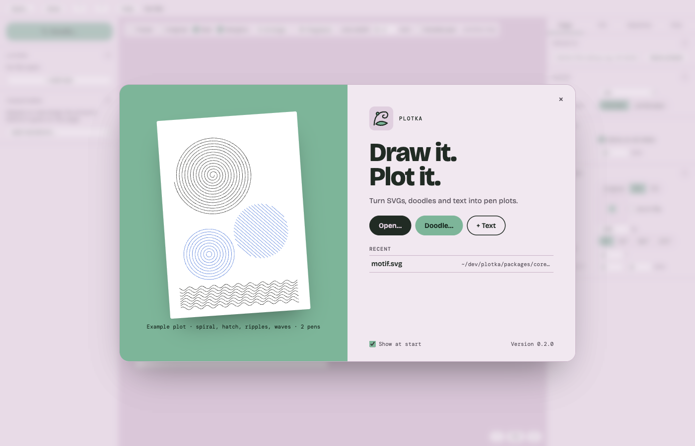

**Status:** early releases for macOS, tested on an AxiDraw V3/A3. Download the app from
[GitHub releases](../../releases/latest).

## Features

- Open SVGs from Illustrator, Inkscape, Figma, Affinity Designer and code, or draw a doodle and
  turn it into clean curves or straight lines. Place rectangles, ellipses, triangles, hexagons
  and stars, and merge, cut or intersect shapes

  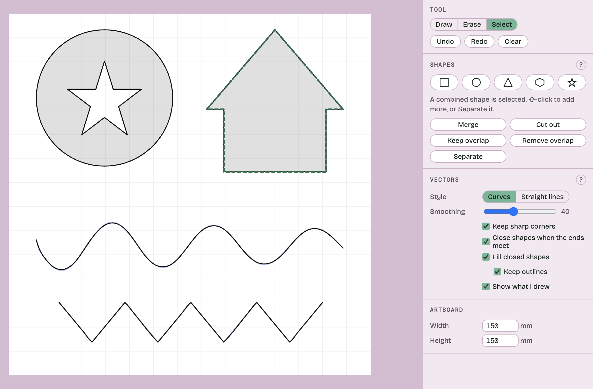

- Layers: each doodle, text or file is a layer with its own fill, pen color, speed and place
  on the page; rename or duplicate them

  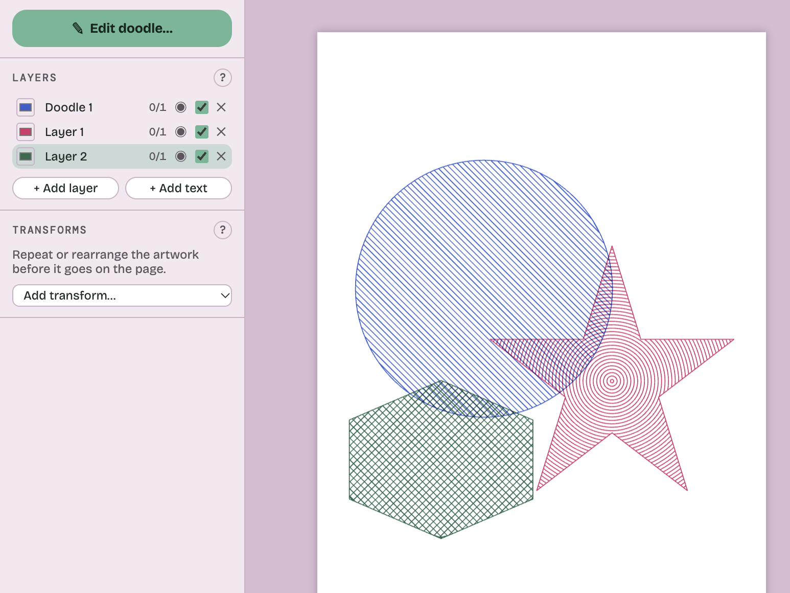

- Pictures (PNG, JPEG, WebP...) become pen marks: ordered or diffusion dithering, or halftone,
  with circles, squares, dots, lines, × or +

  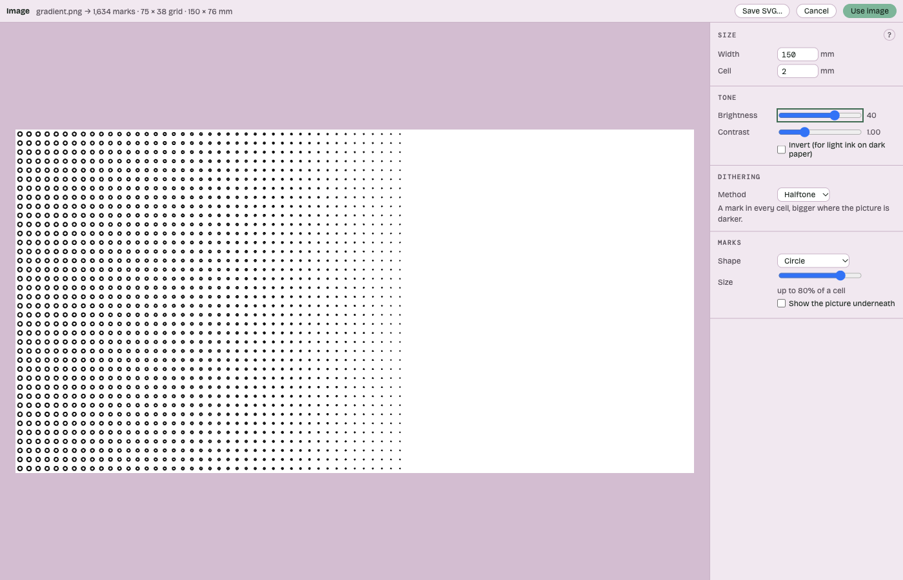

- 3D models (OBJ, STL, PLY, glTF / GLB, 3MF) become parallel slices drawn from any angle, with
  hidden lines removed or the full mesh

  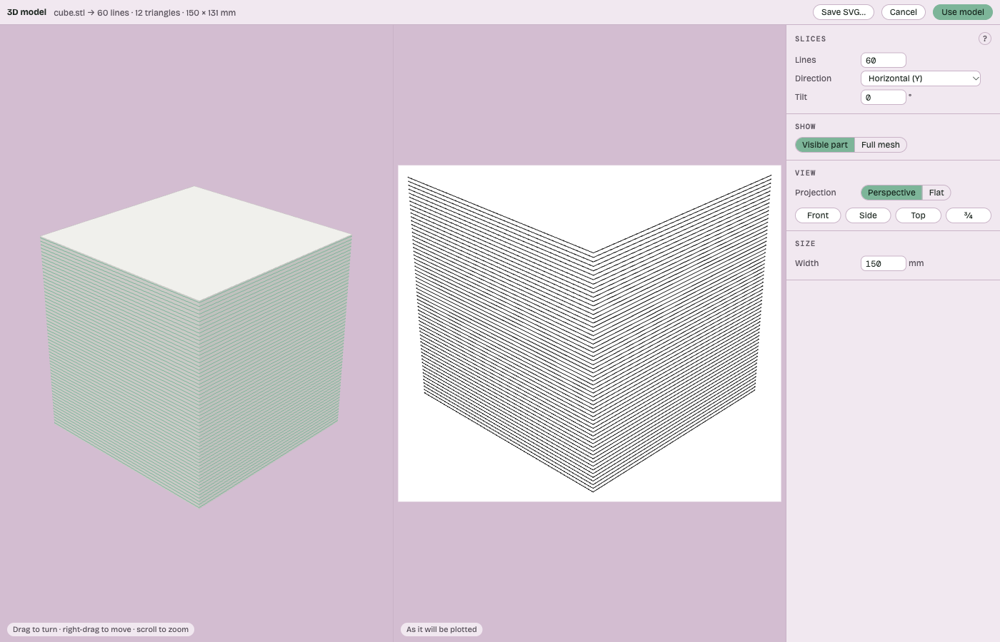

- Paper presets, margins, fit and alignment
- Text in single-stroke Hershey fonts (six styles), typed in the app or from SVG text, and a
  blackletter (plain or ornate) and a Gothic and a Rotunda made of broad-nib strokes for a
  parallel pen, sized from the nib

  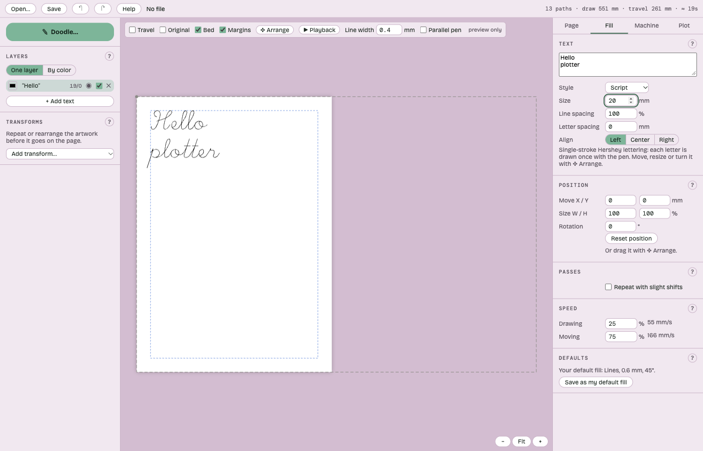

  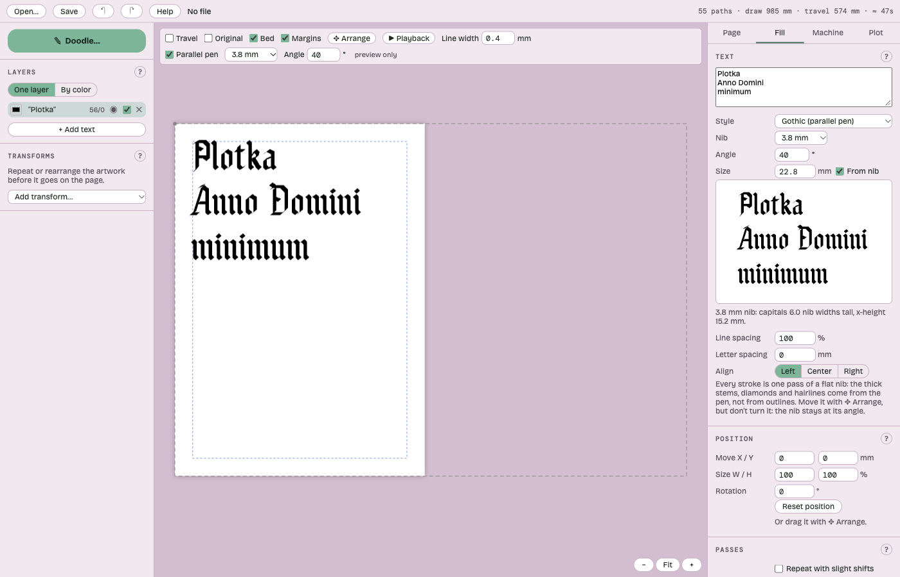

- Fills: lines (or a zigzag), crosshatch, triangles, hexagons, waves (smooth, zigzag, square),
  noise, flow, concentric, spiral, ripples, dots and stipple, with spacing from the fill color;
  keep the pen down between lines, with rounded turns; shapes on top hide the ones underneath,
  like in the file

  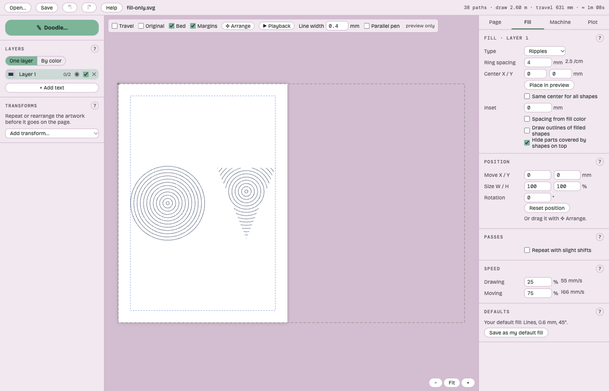

- Passes: plot a layer several times with slight shifts in different colors, for gradients and
  moiré

  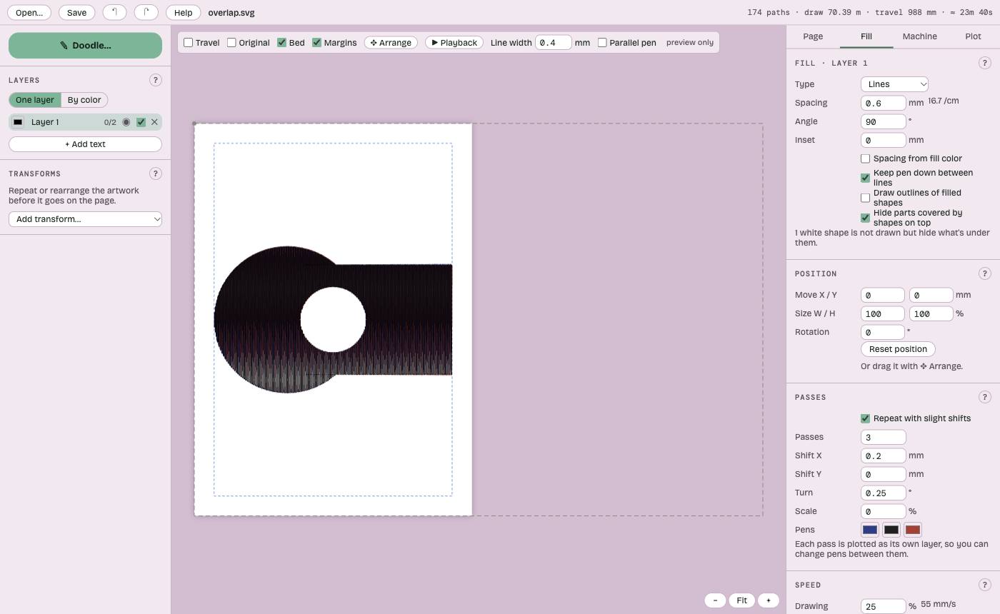

- Transforms: tile on a grid, or tessellate with all 17 wallpaper patterns (square, triangle and
  hexagon rotations, kaleidoscopes, glides)

  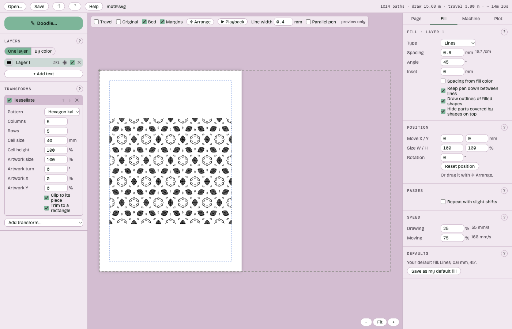

- Path optimization to cut pen-up travel
- Accurate preview with a time estimate from the same motion plan the plotter follows

  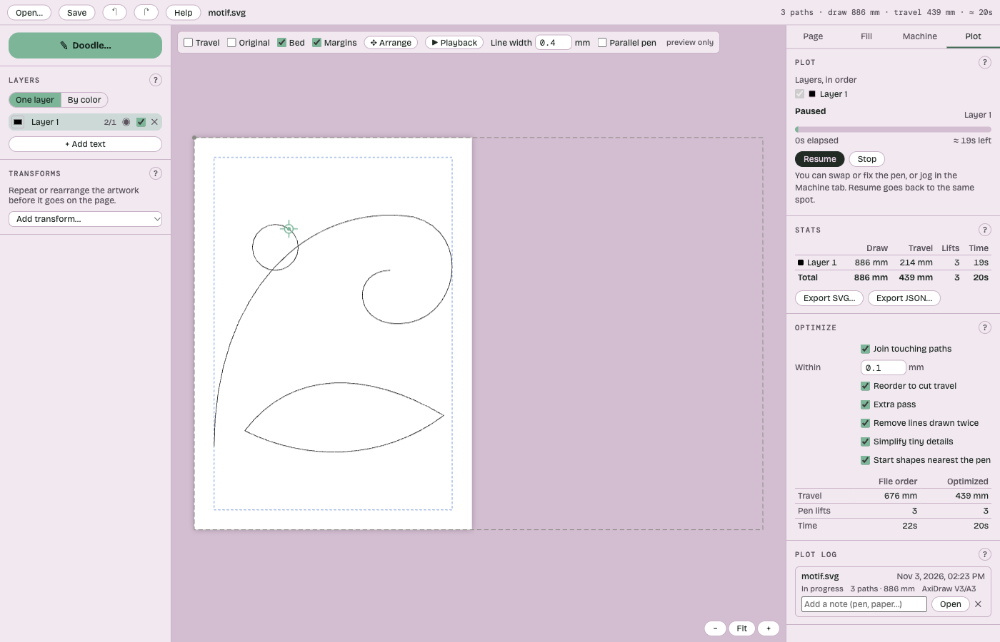

- Direct USB control: connect, jog, pen-height sliders, start / pause / resume / stop, the
  machine's pause button

  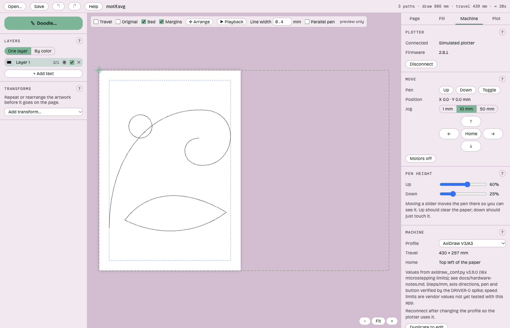

- Projects with undo and redo, a searchable help guide built in, and a log file for bug reports

## User guide

The guide is in the app (**Help**, ⌘?) and in [docs/guide](docs/guide/01-getting-started.md).

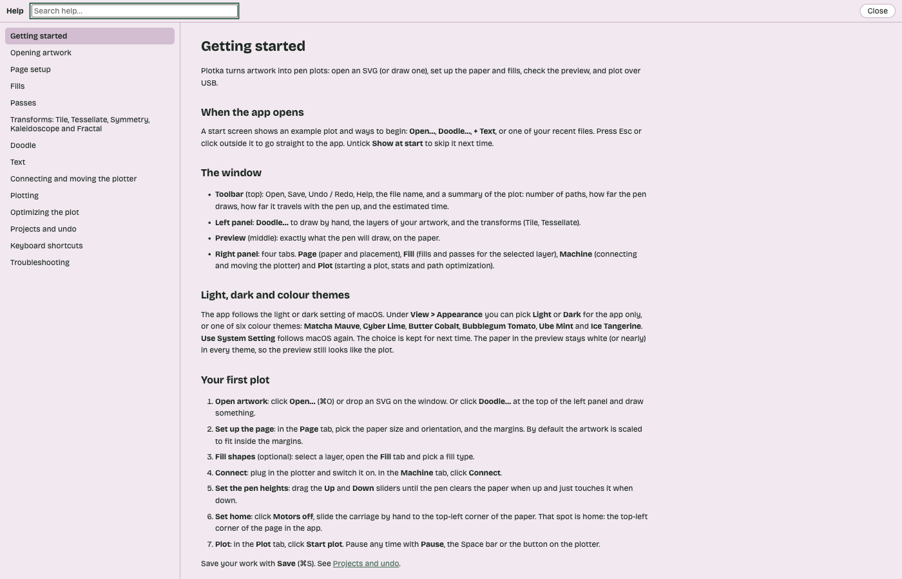

## Supported machines

| Machine                             | Status                |
| ----------------------------------- | --------------------- |
| AxiDraw V3/A3 (standard servo lift) | Primary, tested       |
| Other AxiDraw models                | Untested, PRs welcome |
| Bantam Tools NextDraw               | Untested, PRs welcome |

Any EiBotBoard (EBB) based plotter should work with a machine profile. See
[CONTRIBUTING.md](CONTRIBUTING.md#adding-a-machine-profile).

## Install

Download the `.dmg` from the [latest release](../../releases/latest). It runs on macOS, on
Apple Silicon and Intel. Windows and Linux aren't planned for now, but pull requests that add
them are welcome.

~~The app is not signed with an Apple Developer certificate yet, so macOS blocks it the first
time. To open it:~~

1. ~~Right click the app in Finder and choose **Open**, then **Open** again. Or:~~
2. ~~Try to open it once, then go to **System Settings > Privacy & Security** and click
   **Open Anyway**.~~

nvm, I got the dev subscription. From v0.5.0 the app is signed and notarized, so open the
`.dmg`, drag Plotka to Applications and open it like any other app. (The steps above are still
there for v0.4.0 and older.)

## Development

Requirements: Node 22+, pnpm (`corepack enable pnpm`).

```sh
pnpm install
pnpm dev          # run the app with hot reload
pnpm test         # unit tests (Vitest)
pnpm lint         # ESLint
pnpm typecheck    # TypeScript
pnpm build:mac    # universal (Apple Silicon + Intel) .dmg in apps/desktop/release
pnpm release 0.5.0  # bump, commit and tag a release; see docs/releasing.md
pnpm release:publish  # build, sign, notarize and upload it as a draft release
```

### Repo layout

```
apps/desktop/       Electron main, preload and React renderer
packages/core/      Pure TypeScript geometry: import, fills, optimize, transforms
packages/plotter/   Driver interface, EBB protocol, motion planner, simulator
docs/               Plans, hardware notes, decisions
```

## License

[MIT](LICENSE). AxiDraw is a trademark of Evil Mad Scientist Laboratories, NextDraw is a
trademark of Bantam Tools. This project is not affiliated with either.
