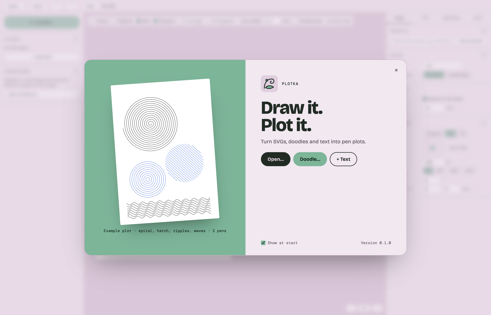

# Plotter Studio

> Working name. The final name is still to be decided.

A desktop app for pen plotters. Load SVG artwork, set up the paper and fills, preview exactly
what the pen will draw, and plot directly over USB, with no vendor software or Inkscape
extension needed.



**Status:** early development. Not ready for use yet.

## Features (planned for 1.0)

- Open SVGs from Illustrator, Inkscape, Figma, Affinity Designer and code
- Paper presets, margins, fit and alignment
- Hatch fills: parallel lines, crosshatch, zigzag
- Path optimization to cut pen-up travel
- Accurate preview with time estimate
- Direct USB control: pen height calibration, jog, start/pause/resume/stop

## Supported machines

| Machine                             | Status           |
| ----------------------------------- | ---------------- |
| AxiDraw V3/A3 (standard servo lift) | Primary, tested  |
| Other AxiDraw models                | Community tested |
| Bantam Tools NextDraw               | Community tested |

Any EiBotBoard (EBB) based plotter should work with a machine profile. See
[CONTRIBUTING.md](CONTRIBUTING.md#adding-a-machine-profile).

## Install

Builds for macOS (Apple Silicon and Intel) will be attached to
[GitHub releases](../../releases). Windows and Linux builds will come later.

The app is not signed with an Apple Developer certificate yet, so macOS blocks it the first
time. To open it:

1. Right click the app in Finder and choose **Open**, then **Open** again. Or:
2. Try to open it once, then go to **System Settings > Privacy & Security** and click
   **Open Anyway**.

## Development

Requirements: Node 22+, pnpm (`corepack enable pnpm`).

```sh
pnpm install
pnpm dev          # run the app with hot reload
pnpm test         # unit tests (Vitest)
pnpm lint         # ESLint
pnpm typecheck    # TypeScript
pnpm build:mac    # build a .dmg into apps/desktop/release
```

### Repo layout

```
apps/desktop/       Electron main, preload and React renderer
packages/core/      Pure TypeScript geometry: import, fills, optimize, transforms
packages/plotter/   Driver interface, EBB protocol, motion planner, simulator
docs/               Plans, hardware notes, decisions
```

## License

[MIT](LICENSE). AxiDraw is a trademark of Evil Mad Scientist Laboratories, NextDraw is a
trademark of Bantam Tools. This project is not affiliated with either.
